# Scattered Look-Ahead Direct-Form II Transposed IIR <!-- omit in toc -->

A parameterizable Scattered Look-Ahead Direct-Form II Transposed Infinite Impulse Response (IIR) filter implemented in SystemVerilog with verification using a MATLAB scripts and SystemVerilog Testbench.

Clone the Repo:

```
git clone https://github.com/pletnevAE/sla_iir_df2t.git
```

## Contents <!-- omit in toc -->

- [Overview](#overview)
- [Theoretical basis](#theoretical-basis)
  - [Mathematical description](#mathematical-description)
  - [Stability analysis and phase characteristics](#stability-analysis-and-phase-characteristics)
  - [Canonical Forms and cascaded Implementation (SOS)](#canonical-forms-and-cascaded-implementation-sos)
  - [Speed limit of recursive filters](#speed-limit-of-recursive-filters)
  - [Scattered Look-Ahead](#scattered-look-ahead)
  - [Fixed-point arithmetic and L1-norm](#fixed-point-arithmetic-and-l1-norm)
- [Fractional length and quantization noise](#fractional-length-and-quantization-noise)
- [Architecture](#architecture)
- [Interface](#interface)
  - [Parameters](#parameters)
  - [Signals](#signals)
- [Utilization](#utilization)
- [Simulation](#simulation)
- [Building the project out-of-the-box](#building-the-project-out-of-the-box)

## Overview

The module is designed for high-speed digital filtering within FPGA-based digital signal processing (DSP) chains. Direct implementations of recursive IIR filters suffer from a strict combinational feedback bottleneck that limits the maximum operating frequency ($F_{max}$). This project implements the **Scattered Look-Ahead (SLA)** transformation and retiming to pipeline the feedback loop, enabling high-throughput streaming processing at high clock rates while maintaining precise fixed-point scaling based on $L_1$-norm analysis.

Typical applications:

- software defined radio (SDR);
- audio and video signal processing;
- digital communications;
- medical equipment;
- radiolocation and navigation;
- industry.

## Theoretical basis

IIR digital filters represent a class of discrete-time linear time-invariant (LTI) systems containing feedback loops. The presence of feedback results in an infinite duration of the system's response to a unit impulse, fundamentally distinguishing them from FIR (Finite Impulse Response) filters.

### Mathematical description

The time domain of an IIR filter is described by a linear difference equation with constant coefficients:

$$y[n] = \sum_{k = 0}^{M}{b_k \cdot x[n - k]} - \sum_{k = 1}^{N}{a_k \cdot y[n - k]}$$

where $x[n]$ is the input signal, $y[n]$ is the output signal, $b_k$ are the feedforward (numerator) coefficients, and $a_k$ are the feedback (denominator) coefficients. The minus sign before the second sum is a standard academic convention, although practical implementations often use addition with inverted coefficients.

Applying the $Z$-transform to both sides of the difference equation yields the system's transfer function in the $Z$-domain:

$$H(z) = \frac{Y(z)}{X(z)} = \frac{\sum_{k = 0}^{M}{b_k \cdot z^{-k}}}{1 + \sum_{k = 1}^{N}{a_k \cdot z^{-k}}}$$

This rational function fully defines the frequency characteristics of the filter. The roots of the numerator polynomial are called zeros, and the roots of the denominator polynomial are called poles.

### Stability analysis and phase characteristics

- **Stability**: unlike FIR filters, which are unconditionally stable, IIR filters are potentially unstable. A necessary and sufficient condition for the stability of a system is that all poles of the transfer function lie strictly inside the unit circle on the complex $Z$-plane ($|p_k| < 1$).

<p align="center">
  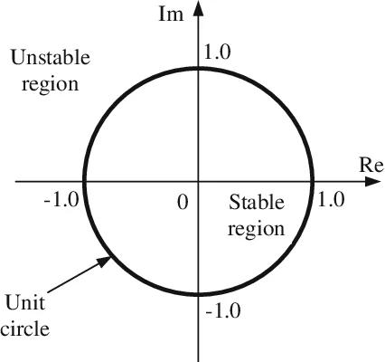
</p>

- **Phase characteristics**: IIR filters fundamentally cannot possess a strictly linear phase response (with the exception of specialized filtering techniques, such as forward-backward filtering). This leads to non-uniform group delay and dispersion distortion of wideband signals.

<p align="center">
  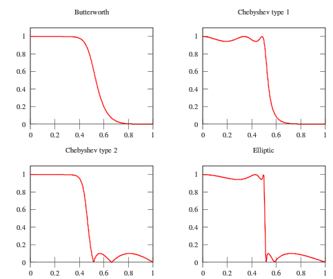
</p>

### Canonical Forms and cascaded Implementation (SOS)

Implementing high-order IIR filters as a single polynomial (direct form) is associated with critical sensitivity of the roots (poles) to coefficient quantization errors. When transitioning to hardware architectures, the transfer function is factored into a cascade of biquadratic Second-Order Sections (SOS):

$$H(z) = g \cdot \prod_{k = 1}^{k} \frac{b_{0k} + b_{1k} \cdot z^{-1} + b_{2k} \cdot z^{-2}}{1 + a_{1k} \cdot z^{-1} + a_{2k} \cdot z^{-2}}$$

where $g$ is the overall gain coefficient.

<p align="center">
  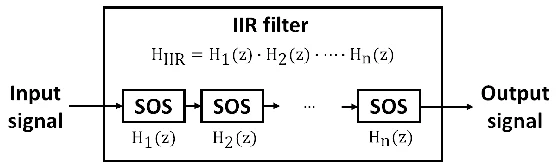
</p>

To implement each section (biquad) in the RTL logic, **Direct-Form II (DF2)** is most commonly used. This form is canonical in terms of the number of delay elements:

- **State node**: $v[n] = x[n] - a_1 \cdot v[n - 1] - a_2 \cdot v[n - 2]$
- **Output equation**: $y[n] = b_0 \cdot v[n] + b_1 \cdot v[n - 1] + b_2 \cdot v[n - 2]$

The DF-II form presents the following issue: a long serial chain of adders is formed at the input of the delay line. The signal must propagate through the multipliers and all the adders within a single clock cycle before reaching the first delay register. This creates a long combinational path that severely limits the device's $F_{max}$.

To address this issue, the **Direct-Form II Transposed (DF2T)** form can be used, in which registers are distributed between the adders. As a result, the critical path between any two registers comprises only one multiplier and one adder. This enables the filter to operate at significantly higher clock frequencies without the need for complex pipelining. It's equations for a biquad:

$$s_1[n] = b_1 \cdot x[n] - a_1 \cdot y[n] + s_2[n - 1],$$
$$s_2[n] = b_2 \cdot x[n] - a_2 \cdot y[n],$$
$$y[n] = b_0 \cdot x[n] + s_1[n - 1].$$

<p align="center">
  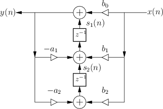
</p>

### Speed limit of recursive filters

The $F_{max}$ of digital logic is determined by the longest combinational path between two registers. In the feedforward part of a filter this path can always be shortened by inserting pipeline registers (the only price is a larger latency).

The feedback part is different, in the DF2T biquad the output $y[n]$ depends on $y[n - 1]$ through one multiplier (by $a_1$), the adder in front of the state register $v_1$, the adder of the output $y$ and a rounding block, and there is only one delay in this loop. The clock period therefore cannot be smaller than

$$T_{clk} \ge T_{mult} + 2 \cdot T_{add} + T_{round}.$$

An additional register inside the loop would add one more delay, i.e. it would change the transfer function. In general, the lower limit on the clock period of a recursive algorithm is determined by the slowest loop:

$$T_{\infty} = \max_{l} \frac{T_l}{D_l},$$

where $T_l$ is the total computation time of the operations in loop $l$ and $D_l$ is the number of delays in it. To make the filter faster, the number of delays $D_l$ in the loops has to be increased without changing the input-output behavior of the filter. This is what look-ahead does.

### Scattered Look-Ahead

The idea of ​​look-ahead is most easily understood using the example of a first-order filter with a pole $p$:

$$H(z) = \frac{1}{1 - p \cdot z^{-1}} \quad\Longleftrightarrow\quad y[n] = x[n] + p \cdot y[n - 1]$$

In the time domain, look-ahead means substituting the equation for $y[n - 1]$ into the equation for $y[n]$:

$$y[n] = x[n] + p \cdot x[n - 1] + p^2 \cdot y[n - 2].$$

Now $y[n]$ depends on $y[n - 2]$, so the loop contains two delays. In the $z$-domain this is a multiplication of the numerator and denominator by $(1 + p \cdot z^{-1})$:

$$H(z) = \frac{1}{1 - p \cdot z^{-1}} \cdot \frac{1 + p \cdot z^{-1}}{1 + p \cdot z^{-1}} = \frac{1 + p \cdot z^{-1}}{1 - p^2 \cdot z^{-2}}.$$

The price is one additional feedforward term, which can be pipelined freely. For an arbitrary depth $M$ the factor is $1 + p \cdot z^{-1} + \dots + p^{M - 1} \cdot z^{-(M - 1)}$, and the new denominator is $1 - p^M \cdot z^{-M}$.

For a higher-order filter this operation is applied to every pole. The result is called scattered look-ahead because the new denominator polynomial $A'(z)$ contains only the powers $z^{-M}, z^{-2 \cdot M}, \dots$ and all the terms between them are zero.

In terms of poles: each original pole $p_i$ is replaced by $M$ poles $p_i \cdot e^{j 2 \pi k / M}$, $k = 0 \dots M - 1$, which are scattered with equal angular spacing over the circle $|z| = |p_i|$. The poles added in this way are cancelled by the zeros of the numerator, so the overall transfer function is unchanged. Since the radius of the poles is not changed, the transformed filter remains stable.

Now let us consider a single biquad. Let its denominator and numerator have the following forms:

$$A(z) = 1 + a_1 \cdot z^{-1} + a_2 \cdot z^{-2} = (1 - p_1 \cdot z^{-1}) \cdot (1 - p_2 \cdot z^{-1}),$$
$$B(z) = b_0 + b_1 \cdot z^{-1} + b_2 \cdot z^{-2}$$

The SLA transformation for the look-ahead depth $M$ consists of three steps:

The SLA transformation for the look-ahead depth $M$ consists of three steps:

1. **New denominator** - raise every pole to the power $M$:

   ```math
    A'(z) = (1 - p_1^M \cdot z^{-M}) \cdot (1 - p_2^M \cdot z^{-M}) = 1 + a'_M \cdot z^{-M} + a'_{2M} \cdot z^{-2M},
   ```

   ```math
    a'_M = -(p_1^M + p_2^M),
   ```

   ```math
    a'_{2M} = (p_1 \cdot p_2)^M = a_2^M.
   ```

   To avoid finding the poles $p_1$ and $p_2$, the sum of the powers of the poles ($S_M = p_1^M + p_2^M$), can be calculated using a linear recurrence defined by the coefficients $a_1$ and $a_2$:

   ```math
    \begin{cases}
    S_0 = 2, \\
    S_1 = -a_1, \\
    S_k = -a_1 \cdot S_{k - 1} - a_2 \cdot S_{k - 2}, k \ge 2.
    \end{cases}
    \xRightarrow{M = 2}
    S_2 = -a_1 \cdot S_1 - a_2 \cdot S_0 = a_1^2 - 2 \cdot a_2.
    \implies
    \begin{cases}
    a'_2 = 2 \cdot a_2 - a_1^2, \\
    a'_{4} = a_2^2.
    \end{cases}
   ```

2. **Compensating polynomial** - the new denominator must equal the old one multiplied by some polynomial $P(z)$:

   ```math
    A'(z) = A(z) \cdot P(z)
   ```

   The polynomial multiplication is a convolution, which is a matrix-vector product with a Toeplitz matrix built from the coefficients of $A$. Since $P(z)$ has $2M - 1$ unknown coefficients $p_0 \dots p_{2M - 2}$ and $A'(z)$ has $2M + 1$ coefficients, this is a system of linear equations (SLAE) with $2M + 1$ equations and $2M - 1$ unknowns. For $M = 2$:

   ```math
    \begin{bmatrix}
    1 & 0 & 0 \\
    a_1 & 1 & 0 \\
    a_2 & a_1 & 1 \\
    0 & a_2 & a_1 \\
    0 & 0 & a_2
    \end{bmatrix}
    \begin{bmatrix} p_0 \\ p_1 \\ p_2 \end{bmatrix}
    =
    \begin{bmatrix} 1 \\ 0 \\ a'_2 \\ 0 \\ a'_4 \end{bmatrix}
   ```

   The system is consistent. Because $A(z)$ is monic (the leading coefficient is 1), the first $2M - 1$ rows form a lower-triangular system that is solved by forward substitution:

   ```math
    \begin{aligned}
    p_0 &= 1, \\
    p_1 &= -a_1, \\
    p_2 &= a'_2 - a_1 \cdot p_1 - a_2 \cdot p_0 = a_2.
    \end{aligned}
   ```

   The last two rows are only consistency checks:

   ```math
    \begin{aligned}
    a_2 \cdot p_1 + a_1 \cdot p_2 &= -a_1 \cdot a_2 + a_1 \cdot a_2 = 0, \\
    a_2 \cdot p_2 &= a_2^2 = a'_4.
    \end{aligned}
   ```

   For $M = 2$ the result is

   ```math
    P(z) = 1 - a_1 \cdot z^{-1} + a_2 \cdot z^{-2} = A(-z),
   ```

   so $A'(z) = A(z) \cdot A(-z)$ is an even polynomial. In general

   ```math
    P(z) = \prod_i \sum_{k = 0}^{M - 1} p_i^k z^{-k}.
   ```

3. **New numerator** - to keep the transfer function unchanged, the numerator is multiplied by the same polynomial, i.e. by the Toeplitz matrix of $B$:

   ```math
    \begin{bmatrix} b'_0 \\ b'_1 \\ b'_2 \\ b'_3 \\ b'_4 \end{bmatrix}
    =
    \begin{bmatrix}
    b_0 & 0 & 0 \\
    b_1 & b_0 & 0 \\
    b_2 & b_1 & b_0 \\
    0 & b_2 & b_1 \\
    0 & 0 & b_2
    \end{bmatrix}
    \begin{bmatrix} p_0 \\ p_1 \\ p_2 \end{bmatrix}
   ```

   In the results

   ```math
    \begin{aligned}
    b'_0 &= b_0, \\
    b'_1 &= b_1 - b_0 \cdot a_1, \\
    b'_2 &= b_2 - b_1 \cdot a_1 + b_0 \cdot a_2, \\
    b'_3 &= b_1 \cdot a_2 - b_2 \cdot a_1, \\
    b'_4 &= b_2 \cdot a_2.
    \end{aligned}
   ```

The section becomes

$$H'(z) = \frac{B'(z)}{A'(z)} = \frac{b'_0 + b'_1 \cdot z^{-1} + b'_2 \cdot z^{-2} + b'_3 \cdot z^{-3} + b'_4 \cdot z^{-4}}{1 + a'_2 \cdot z^{-2} + a'_4 \cdot z^{-4}}.$$
$$y[n] = x[n] \sum_{k = 1}^{4}{b'_k \cdot x[n - k]} - a'_2 \cdot y[n - 2] - a'_4 \cdot y[n - 4].$$

While retiming allows for the placement of registers after the multipliers, achieving a significant increase in the maximum operating frequency for a DF2T IIR filter is not feasible; this is due to the emergence of critical paths spanning two adders and the rounding unit.

<p align="center">
  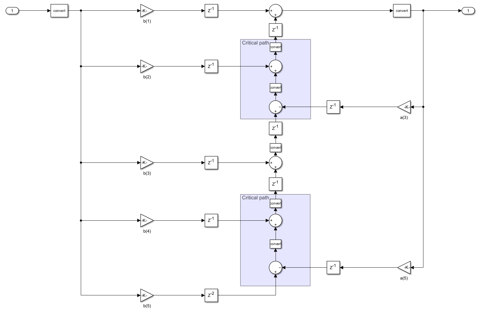
</p>

The main disadvantages of SLA are:

- **More hardware**: a section with 4 multipliers becomes a section with 6 multipliers for $M = 2$;
- **Cancellation is exact only in infinite precision**: with quantized coefficients the zeros of $B'(z)$ no longer cancel the extra poles of $A'(z)$ exactly, so the fixed-point SLA section differs from the original one. The noise gain of the section is also different.
- **Latency**: the pipeline registers add a delay of a few samples per section.

### Fixed-point arithmetic and L1-norm

A signed fixed-point number is an integer in two's complement that is interpreted with an implicit binary point:

$$value = \frac{integer}{2^{FL}}.$$

It is characterized by the **word length** $WL$ (the total number of bits), the **fraction length** $FL$ (the number of bits after the binary point) and the **integer length** $IL = WL - FL$ (the number of bits before the binary point, including the sign bit). The range is $[-2^{IL - 1}, \ 2^{IL - 1} - 2^{-FL}]$ and resolution (LSB) is $2^{-FL}$.

Transitioning from mathematical models to the physical layer using fixed-point arithmetic introduces several nonlinear effects requiring rigorous analysis:

- **Limit cycles**: in the absence of an input signal, the nonlinearity of truncation (or rounding) in the feedback loop can cause the filter to self-oscillate, producing low-amplitude periodic oscillations.
- **Overflow**: exceeding the bit width in feedback adders causes a "wrap-around" effect, leading to high-amplitude oscillations. To combat this, saturation arithmetic and scaling of the computation graph's input nodes.
- **Quantization noise**: limiting the coefficient bit width shifts the poles from their ideal positions, which degrades the amplitude-frequency response (e.g., reduces stopband attenuation) and decreases the stability margin.

If the integer part of a signal is too short, the signal overflows, and with wrap-around arithmetic an overflow in a recursive filter causes high-amplitude oscillations. If it is too long, bits are wasted and the fractional part, i.e. the precision, shrinks. It is necessary to determine the maximum possible value of each signal within the filter for any input within the permissible range. The $L_1$-norm is used for this purpose, as it establishes a rigorous mathematical bound on the maximum gain of the system or its internal state.

For a discrete-time impulse response $h[n]$ (system response to a Dirac delta function $x[n] = \delta[n]$), The $L_1$-norm is defined as the sum of the absolute values of all impulse response coefficients:

$$\|h\|_1 = \sum_{n = 0}^{\infty}{|h[n]|}.$$

If an input signal $x[n]$ is bounded such that $|x[n]| \le X_{max}$, the output magnitude $y[n]$ (or any internal $s_k[n]$) is strictly bounded by:

$$|y[n]| = \left|\sum_{k}{h[k]\, x[n - k]}\right| \le \sum_{k}{|h[k]|\, |x[n - k]|} \le \|h\|_1 \cdot X_{max}.$$

This guarantees that no overflows will occur if the integer bit width is property dimensioned.

Calculating algorithm:

1. inject a unit impulse $x_{imp} = [1, 0, 0, \dots]$ into each filter section model;
2. compute the exact impulse response $y[n]$ and internal state trajectories $s_k[n]$ over $N_{imp}$ samples;
3. calculate the $L_1$-norm for each state and output:

   ```math
    \|s_k\|_1 = \sum |s_k[n]|.
   ```

4. determine the required $IL$ to prevent overflow:

   ```math
    IL = \lceil \log_2(\|h\|_1) \rceil + 1.
   ```

5. compute $FL$ based on quantization noise transfer function ($L_2$-norm) to satisfy a target signal-to-quantization-noise ratio $SQNR$.

## Fractional length and quantization noise

The $L_1$-norm determines how many bits the integer part needs. The fraction length of the states is determined by the required precision. Every rounding (quantization) in the filter adds an error that can be modeled as white noise with the variance $q^2 / 12$, where $q = 2^{-FL}$ is quantization step. In the DF2T section an error injected at a state node reaches the output through the all-pole transfer function $1 / A'(z)$. With $N_{conv} = 2M + 1$ conversion points per section the noise power at the section output is

$$P_{noise} = N_{conv} \cdot \frac{q^2}{12} \cdot \sum_{n}{h_{noise}^2[n]},$$

where 

$$h_{\text{noise}}[n] = \mathcal{Z}^{-1}\left\lbrace\frac{1}{A'(z)}\right\rbrace.$$

The required $SQNR$ is related to the signal power; for a full-scale sine wave $P_{signal} = 0.5$. Solving

$$\frac{P_{signal}}{P_{noise}} = 10^{SQNR_{dB} / 10}$$

for $q$ gives the maximum allowed step and the minimum fraction length:

$$q^2 = \frac{12 \cdot P_{signal}}{10^{SQNR_{dB} / 10} \cdot N_{conv} \cdot \sum h_{noise}^2[n]},$$
$$FL_{state} = \left\lceil - \tfrac{1}{2} \log_2{q^2} \right\rceil.$$

## Architecture

The architecture consists of a cascaded chain of `N_SEC` sections:

1. **Scaling stage**: inter-section scaling is handled by the **scale_data.sv** module, which multiplies the incoming data by a scaling factor `scale_val` to prevent internal overflow before it enters a section.

    <p align="center">
      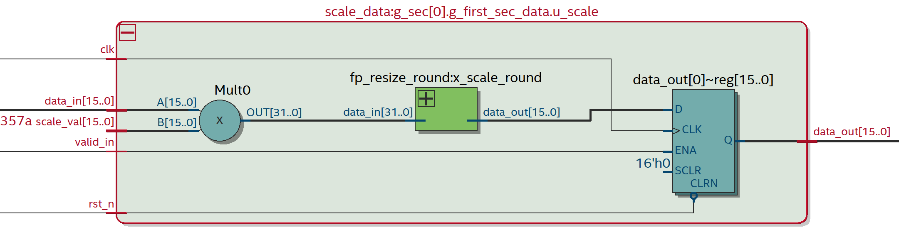
    </p>

2. **SLA DF2T section**: the **iir_sec_df2t.sv** module implements $B'(z) / A'(z)$ as a pipelined DF2T section. The numerator coefficients $b'_1 \dots b'_4$ and the denominator coefficients $a'_2$, $a'_4$ are taken from the ROM of the top module.

    <p align="center">
      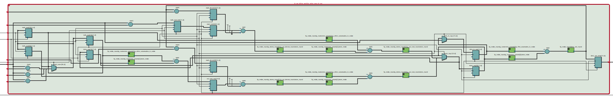
    </p>

3. **Rounding and resizing**: a dedicated **fp_resize_round.sv** module aligns fractional lengths and safely resizes data buses. It supports truncation, nearest, and convergent rounding modes, and includes optional saturation logic to clamp values and prevent wrap-around overflow.

    <p align="center">
      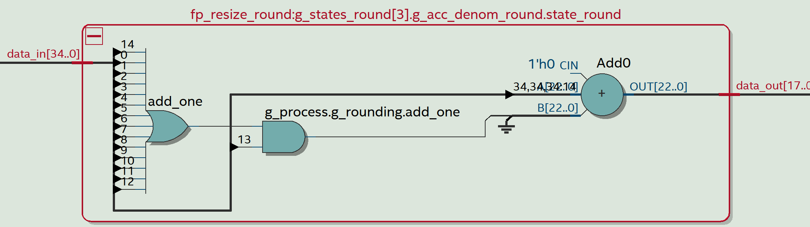
    </p>

4. **Output stage**: if `OUT_MULT = 1` (the last scale value in not equal to 1), the output of the last section is scaled by `s[N_sec]` in one more `scale_data` and converted to the output format. If `OUT_MULT = 0`, the last section rounds it's result to the output format (`OUT_WL`, `OUT_FL`) by itself.
5. **Coefficient ROM**: the coefficients are loaded from the files **b_coeffs.txt**, **a_coeffs.txt** and **scale_coeffs.txt**.
6. **Output Pipeline**: valid data propagates through the pipeline with a total latency of $Latency = 3 \times N_{SEC}$ clock cycles.

<p align="center">
  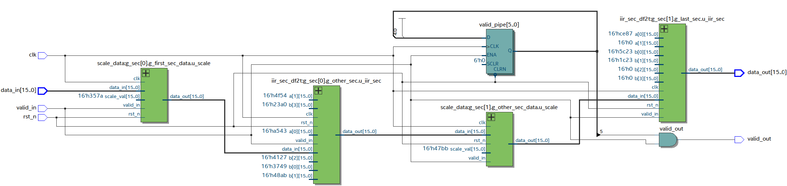
</p>

All registers are updated only when `valid_in = 1`; with a clock frequency that is an integer multiple of the sampling frequency `valid_in` acts as a clock enable.

Key implementation features:

- cascade of `N_SEC` Direct-Form II Transposed sections; each second-order section is implemented as a sparse fourth-order SLA section ($M = 2$);
- the numerator is normalized to $b'_0 = 1$, so the multiplier for $b'_0$ is not needed;
- pipelined (retimed) feedback and feedforward paths;
- automatic selection of optimal bit depths of coefficients, states, multipliers and accumulators by a MATLAB script (**SLA_IIR_calc_auto.m**) using $L_1$-norms;
- lowpass, highpass, bandpass and bandstop filters; Butterworth, Chebyshev I, Chebyshev II and elliptic approximations;
- wrap-around arithmetic without saturation logic;
- asynchronous Active-Low reset (`rst_n`);
- synthesis attributes (`multstyle = "dsp"`) map the multipliers to dedicated DSP blocks;
- latency of $3 \times N_{SEC}$ samples per section;
- a small gain in $F_{max}$ associated with the chosen filter form.

## Interface

### Parameters

Parameter values are passed to the top module using a **iir_params.vh** header file generated by **SLA_IIR_calc_auto.m**.

| Parameter | Constant in **iir_params.vh** | Description |
| :--: | :--: | :--: |
| `N_SEC` | `ORDER / 2` | Number of sections |
| `IN_WL` | `INPUT_WL` | Input word length |
| `IN_FL` | `INPUT_FL` | Input fraction length |
| `OUT_WL` | `OUTPUT_WL` | Output word length |
| `OUT_FL` | `OUTPUT_FL` | Output fraction length |
| `SEC_IN_WL` | `SEC_INPUT_WL` | Section input word length |
| `SEC_IN_FL` | `SEC_INPUT_FL` | Section input fraction length |
| `SEC_OUT_WL` | `SEC_OUTPUT_WL` | Section output word length |
| `SEC_OUT_FL` | `SEC_OUTPUT_FL` | Section output fraction length |
| `STATE_WL` | `STATE_IIR_WL` | State word length |
| `STATE_FL` | `STATE_IIR_FL` | State fraction length |
| `COEFF_WL` | `COEFFICIENT_WL` | Coefficients word length |
| `COEFF_NUM_FL` | `COEFFICIENT_NUM_FL` | Numerator fraction length |
| `COEFF_DENOM_FL` | `COEFFICIENT_DENOM_FL` | Denominator fraction length |
| `SCALE_FL` | `COEFFICIENT_SCALE_FL` | Scale values fraction length |
| `MULT_WL` | `PROD_WL` | Product word length |
| `MULT_NUM_FL` | `PROD_NUM_FL` | Product Numerator fraction length |
| `MULT_DENOM_FL` | `PROD_DENOM_FL` | Product Denominator fraction length |
| `ACC_WL` | `ACCUM_WL` | Accumulator word length |
| `ACC_NUM_FL` | `ACCUM_NUM_FL` | Accumulator Numerator fraction length |
| `ACC_DENOM_FL` | `ACCUM_DENOM_FL` | Accumulator Denominator fraction length |
| `OUT_MULT` | `OUT_MULTIPLIER` | Activation of the output multiplier |
| `ROUND_MODE` | - (default 2) | Rounding method |

### Signals

| Port | Direction | Width | Description |
| :--: | :--: | :--: | :--: |
| `clk` | Input | 1 | Clock signal |
| `rst_n` | Input | 1 | Asynchronous Active-Low Reset |
| `valid_in` | Input | 1 | Input data valid |
| `data_in` | Input | `IN_WL` | Input data |
| `valid_out` | Output | 1 | Output data valid |
| `data_out` | Output | `IN_WL` | Output data |

## Utilization

The project was synthesized for the 10M50DAF484C6GES FPGA on the DE10-Lite board using Quartus 22.1 Standard Edition. The data were obtained under the following parameters: `IN_WL = 16`, `IN_FL = 15`, `H_WL = 16`, `OUT_WL = 16`, `OUT_FL = 14`, `SEC_IN_WL = 16`, `SEC_OUT_WL = 16`, Butterworth approximation.

| FPGA | Option | `N_SEC` | LUT | FF | DSP | $F_{max}$, MHz | Hold Slack, ns | Setup Slack, ns |
| :--: | :--: | :--: | :--: | :--: | :--: | :--: | :--: | :--: |
| 10M50DAF484C6GES | DF2 SOS | 3 | 577 | 332 | 24 | 58.35 | 0.364 | 2.862 |
| 10M50DAF484C6GES | **DF2T SLA** | 3 | 1070 | 578 | 42 | 80.35 | 0.362 | 7.554 |
| 10M50DAF484C6GES | DF2 SOS | 5 | 946 | 544 | 40 | 58.18 | 0.362 | 2.811 |
| 10M50DAF484C6GES | **DF2T SLA** | 5 | 1632 | 807 | 70 | 79.99 | 0.362 | 7.498 |
| 10M50DAF484C6GES | DF2 SOS | 6 | 1143 | 650 | 48 | 58.02 | 0.362 | 2.766 |
| 10M50DAF484C6GES | **DF2T SLA** | 6 | 2037 | 1074 | 84 | 75.77 | 0.361 | 6.803 |
| 10M50DAF484C6GES | DF2 SOS | 10 | 1913 | 1069 | 80 | 56.90 | 0.362 | 2.425 |
| 10M50DAF484C6GES | **DF2T SLA** | 10 | 3335 | 1686 | 140 | 78.43 | 0.362 | 7.250 |

## Simulation

Before running simulation, a MATLAB script **SLA_IIR_calc_auto.m** is used to generate the stimulus signal, the **iir_params.vh** header file and the files with coefficients (**b_coeffs.txt**, **a_coeffs.txt**, **scale_coeffs.txt**). To call the script from outside the project's out-of-the-box build script, use the following format:

```
SLA_IIR_calc_auto('<build_path>', {'-F_CLK <value> -F_S <value> -FILTER_TYPE <string> -FILTER_APPROX <string> -F_PASS <value> -F_STOP <value> -F_PASS1 <value> -F_PASS2 <value> -F_STOP1 <value> -F_STOP2 <value> -A_PASS <value> -A_STOP <value> -A_PASS1 <value> -A_PASS2 <value> -A_STOP1 <value> -A_STOP2 <value> -IN_WL <value> -IN_FL <value> -H_WL <value> -OUT_WL <value> -OUT_FL <value> -SEC_IN_WL <value> -SEC_OUT_WL <value>'})
```

The script performs the following steps:

1. designs the reference SOS filter (**IIR_Calculation.m**);
2. applies the SLA transformation with $M = 2$ (**SLA_calc.m**);
3. converts the coefficients to fixed-point and calculates the $L_1$-norms and all word/fraction lengths (**L1_calc.m**);
4. builds a bit-accurate fixed-point model of the cascade in MATLAB and plots the magnitude responses *Original SOS (double)*, *SLA (double)* and *SLA (fixed_point)*, which are saved in .png format to the build directory (**MagResponse.png**);
5. generates the stimulus: five segments of 500 samples each, sine waves with the amplitude 0.9 and the frequencies $F_{pass} / 10$, $F_{pass} / 2$, $F_{pass}$, 2 F_{pass}$ and $2.5 F_{pass}$, with added Gaussian noise (standard deviation 0.03);
6. writes the coefficients, the parameter header, thi stimulus and a **params.mat** file with the parameters for the analysis script.

After placing the generated files into the project root folder, it is necessary to set the required parameters in the SystemVerilog **testbench.sv**. By default, parameters are taken from the **iir_params.vh**.

| Parameter | Default Value | Description |
| :--: | :--: | :--: |
| `N_SEC` | - | Number of sections |
| `IN_WL` | - | Input word length |
| `IN_FL` | - | Input fraction length |
| `OUT_WL` | - | Output word length |
| `OUT_FL` | - | Output fraction length |
| `SEC_IN_WL` | - | Section input word length |
| `SEC_IN_FL` | - | Section input fraction length |
| `SEC_OUT_WL` | - | Section output word length |
| `SEC_OUT_FL` | - | Section output fraction length |
| `STATE_WL` | - | State word length |
| `STATE_FL` | - | State fraction length |
| `COEFF_WL` | - | Coefficients word length |
| `COEFF_NUM_FL` | - | Numerator fraction length |
| `COEFF_DENOM_FL` | - | Denominator fraction length |
| `SCALE_FL` | - | Scale values fraction length |
| `MULT_WL` | - | Product word length |
| `MULT_NUM_FL` | - | Product Numerator fraction length |
| `MULT_DENOM_FL` | - | Product Denominator fraction length |
| `ACC_WL` | - | Accumulator word length |
| `ACC_NUM_FL` | - | Accumulator Numerator fraction length |
| `ACC_DENOM_FL` | - | Accumulator Denominator fraction length |
| `OUT_MULT` | - | Activation of the output multiplier |
| `ROUND_MODE` | 2 | Rounding method (default - convergent) |
| `CLK_PERIOD` | - | Clock period in ns |
| `CLK_ENABLE_DIV` | - | Clock division factor for determining the clock enable frequency |
| `RESET_CYCLES` | 10 | Number of clock cycles before reset release |
| `NUM_SAMPLES` | - | Number of stimulus samples |

The testbench reads the samples from **stimulus.txt**, applies one sample on every `valid_in` strobe and writes every output sample with `valid_in = 1` to **output_iir.txt**. The simulation finishes when the number of written samples is equal to the number of the stimulus samples.

<p align="center">
  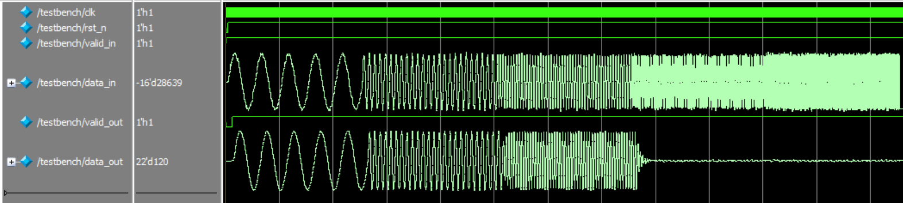
</p>

A MATLAB script **IIR_analyze_auto.m** is used to analyze the obtained results. To call the script from outside the project's out-of-the-box build script, use the following format:

```
IIR_analyze_auto('<build_path>')
```

It reads the files generated during the simulation, calculates the original IIR filter (without the SLA transformation) with double-type coefficients based on the given characteristics, and determines the absolute and RMS error and $SQNR$ of the RTL output relative to it. Thus the reported error includes both the quantization and the effect of the SLA transformation in finite precision.

Upon completion, the script plots the RTL IIR output signal alongside the reference IIR output, as well as the absolute errors.

<p align="center">
  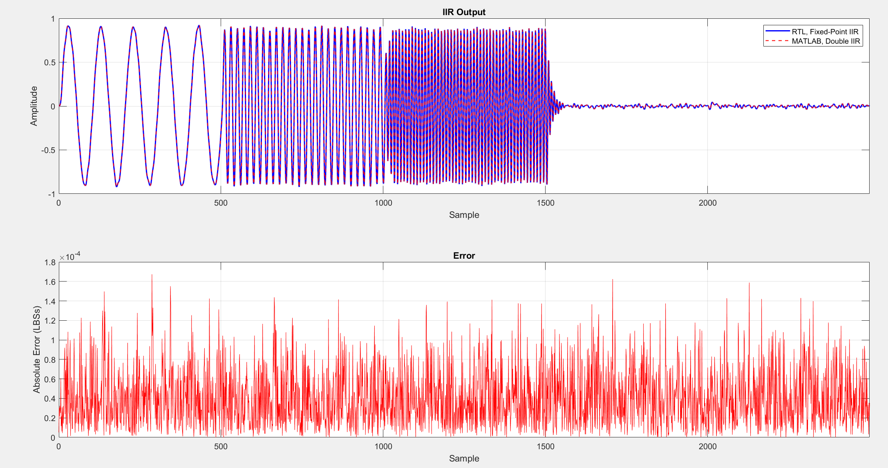
</p>

The calculated values for these parameters are also displayed in the console:

```
==================== SLA IIR REPORT ====================
Filter Type                        : lowpass
Design Method                      : cheby2
Filter Order                       : 20
Pipelining depth                   : 2
Input Word length                  : 16
Input Fraction length              : 15
Output Word length                 : 22
Output Fraction length             : 15
Coeff Word length                  : 24
Coeff Num. Fraction length         : 21
Coeff Denom. Fraction length       : 23
Scale Values Fraction length       : 23
Section Input Word length          : 22
Section Input Fraction length      : 18
Section Output Word length         : 22
Section Output Fraction length     : 18
State Word length                  : 18
State Fraction length              : 14
Product Word length                : 46
Product Num. Fraction length       : 39
Product Denom. Fraction length     : 41
Accum. Word length                 : 49
Accum. Num. Fraction length        : 41
Accum. Denom. Fraction length      : 41

--------------------------------------------------------
Maximum Absolute Error             : 1.673160e-04
RMS Error                          : 4.879027e-05
Actual Measured SQNR               : 80.09 dB

========================================================
```

## Building the project out-of-the-box

Scripts **run_build.bat**, **build.tcl**, **timing.tcl** and **sim.tcl** are implemented for building the project out-of-the-box. The script also starts the generation of the necessary files (**SLA_IIR_calc_auto.m**), simulation in Modelsim and comparison of the module outputs with the reference model (**IIR_analyze_auto.m**). For the scripts to work, the path to the **bin64** folder within the Quartus root directory must be included in the `PATH` environment variable in Windows. The MATLAB scripts require the DSP System Toolbox and the Fixed-Point Designer.

To run the script, you need to enter the following in the command line from the directory **scripts**:

```
run_build.bat <build_path> -F_CLK <value> -F_S <value> -FILTER_TYPE <string> -FILTER_APPROX <string> -F_PASS <value> -F_STOP <value> -F_PASS1 <value> -F_PASS2 <value> -F_STOP1 <value> -F_STOP2 <value> -A_PASS <value> -A_STOP <value> -A_PASS1 <value> -A_PASS2 <value> -A_STOP1 <value> -A_STOP2 <value> -IN_WL <value> -IN_FL <value> -H_WL <value> -OUT_WL <value> -OUT_FL <value> -SEC_IN_WL <value> -SEC_OUT_WL <value>
```

To get help on the script, you need to enter the following in the command line:

```
run_build.bat <build_path> --help
```

Setting the parameter flags is not necessary; if one of them (or all of them) is not set, the parameter will take on the default value.

| Flag | Description | Default |
| :-- | :-- | :-- |
| `-F_CLK` | Clock frequency, Hz (must be an integer multiple of `-F_S`) | 100e6 |
| `-F_S` | Sampling frequency, Hz | 100e6 |
| `-FILTER_TYPE` | `lowpass`, `highpass`, `bandpass` or `bandstop` | lowpass |
| `-FILTER_APPROX` | `butter`, `ellip`, `cheby1` or `cheby2` | butter |
| `-F_PASS`, `-F_STOP` | Passband and stopband edges, Hz (lowpass, highpass) | 10e6, 20e6 |
| `-F_PASS1`, `-F_PASS2`, `-F_STOP1`, `-F_STOP2` | Band edges, Hz (bandpass, bandstop) | 10e6, 15e6, 7e6, 18e6 |
| `-A_PASS` | Passband ripple, dB (lowpass, highpass, bandpass) | 3 |
| `-A_STOP` | Stopband ripple, dB (lowpass, highpass, bandstope) | 30 |
| `-A_PASS1`, `-A_PASS2` | Passband ripple of the bandstop filter, dB | 0.1, 0.1 |
| `-A_STOP1`, `-A_STOP2` | Stopband ripple of the bandpass filter, dB | 60, 60 |
| `-IN_WL`, `-IN_FL` | Input word and fraction length | 16, 15 |
| `-OUT_WL`, `-OUT_FL` | Output word and fraction length | 16, 15 |
| `-H_WL` | Coefficients word length | 16 |
| `-SEC_IN_WL`, `-SEC_OUT_WL` | Section input and output word length | 16, 16 |

The state word and fraction lengths, as well as all product and accumulator lengths, are calculated automatically by the $L_1$-norm analysis and are not set from the command line. The look-ahead depth $M = 2$ must not be changed, because the RTL implements exactly this depth.

The scripts output project build information, a Compilation Report, STA results to the console and MATLAB chart.
